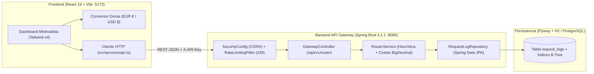

# 🛠️ Manual del Programador — AI Cost Router

Este documento constituye la referencia técnica oficial de **AI Cost Router** para desarrolladores, arquitectos de software e ingenieros de QA. Describe la arquitectura interna, el modelo de datos, el motor de enrutamiento y costes, las políticas de seguridad y la estructura del Frontend.

---

## 🏗️ 1. Arquitectura General del Sistema

**AI Cost Router** sigue una arquitectura desacoplada **Full-Stack** dividida en dos aplicaciones principales dentro del monorrepo:

### Stack Tecnológico
| Capa | Tecnologías Clave |
| :--- | :--- |
| **Backend (`airouter/`)** | Java 21, Spring Boot 4.1.1 (WebMVC, Data JPA, Validation, Security Filter), Lombok, Maven Wrapper. |
| **Base de Datos** | Flyway (`spring-boot-starter-flyway` + `flyway-core`), H2 en memoria (`jdbc:h2:mem:airouterdb`) en desarrollo/tests, preparado para PostgreSQL en producción. Validación estricta `spring.jpa.hibernate.ddl-auto=validate`. |
| **Frontend (`frontend/`)** | React 19, TypeScript 5.9, Vite 8, Tailwind CSS v4 (`@tailwindcss/vite`), Lucide React, Recharts. |
| **Testing / QA** | Backend: JUnit 5, Mockito, Spring MockMvc, AssertJ (38 tests). Frontend: Vitest, React Testing Library, jsdom (10 tests). |

---

## 🗄️ 2. Capa de Persistencia y Esquema de Datos (`05-arquitecto-datos`)

### 2.1. Gobernanza con Flyway
Hibernate tiene prohibido generar o alterar tablas automáticamente (`ddl-auto=validate`). Cualquier cambio estructural requiere crear una nueva migración versionada en `airouter/src/main/resources/db/migration/`.

* **Migración inicial (`V1__create_request_logs_table.sql`):**
  * Crea la tabla `request_logs` con clave primaria `UUID`.
  * Define tres índices B-Tree para optimizar las consultas analíticas y de historial:
    * `idx_request_logs_user_id` (filtrado por usuario).
    * `idx_request_logs_created_at` (ordenación cronológica descendente).
    * `idx_request_logs_model_routed` (agregación por modelo).

### 2.2. Entidad JPA (`RequestLog.java`)
Ubicada en `com.tuproyecto.airouter.models.entities.RequestLog`:
* **Regla de Oro de Lombok en JPA:** No utiliza `@Data`, `@ToString` ni `@EqualsAndHashCode` para evitar problemas de rendimiento y recursión con proxies de Hibernate. Emplea `@Getter`, `@Setter`, `@Builder`, `@NoArgsConstructor`, `@AllArgsConstructor` e implementa `equals` y `hashCode` manualmente basándose exclusivamente en el identificador `id`.
* **Asignación automática de fecha:** El callback `@PrePersist` inicializa `createdAt` con `LocalDateTime.now()` si no fue establecido previamente.

---

## ⚙️ 3. Arquitectura del Backend (`01-backend-java`)

El paquete base es `com.tuproyecto.airouter` y se estructura en capas estrictas:

### 3.1. Contratos DTO (`models/dto/`)
Todos los DTOs están implementados como **`record` inmutables de Java 21**:
* **`PromptRequest`:** Cuerpo de entrada para `POST /api/v1/router/prompt` con validaciones Jakarta (`@NotBlank` en `userId` y `prompt`, `@Size(max = 120)` en `userId`).
* **`RouterResponse`:** Respuesta detallada tras evaluar y persistir un prompt (`id`, `userId`, `promptContent`, `modelRouted`, `tokensEstimated`, `simulatedResponse`, `createdAt`).
* **`RouterStatsResponse`:** Métricas agregadas y financieras (`totalRequests`, `totalTokensEstimated`, `fastModelRequests`, `proModelRequests`, `fastModelTokens`, `proModelTokens`, `estimatedActualCostUsd`, `estimatedBaselineProCostUsd`, `estimatedSavingsUsd`, `savingsPercentage`).
* **`ErrorResponse`:** Formato estándar de error JSON (`timestamp`, `status`, `error`, `message`, `path`, `validationErrors`).

### 3.2. Motor de Enrutamiento y Cálculo Financiero (`services/RouterService.java`)
`RouterService` concentra las tres reglas de negocio nucleares:

1. **Estimación de Tokens (`estimateTokens`):**
   * Divide el prompt limpio por espacios en blanco (`\\s+`), cuenta las palabras y aplica un factor multiplicador de **1.3 tokens por palabra** (`TOKENS_PER_WORD_FACTOR = 1.3`), redondeando al alza (`Math.ceil`).
2. **Selección Inteligente de Modelo (`selectOptimalModel`):**
   * Evalúa si los tokens estimados superan el umbral **`SIMPLE_PROMPT_MAX_TOKENS` (`50`)** o si el texto en minúsculas contiene alguna palabra clave de alta complejidad (`COMPLEX_KEYWORDS`: `"arquitectura"`, `"refactorizar"`, `"optimizar"`, `"analizar en profundidad"`).
   * Si cumple alguna condición ➔ enruta a **`gemini-2.5-pro`**. En caso contrario ➔ enruta a **`gemini-2.5-flash`**.
3. **Cálculo de Costes y Ahorro con `BigDecimal` (`getStats`):**
   * Utiliza aritmética `BigDecimal` con `RoundingMode.HALF_UP` y escala de **6 decimales** para evitar errores de coma flotante (`double`):
     * Tarifa `gemini-2.5-flash`: **`$0.15` USD / 1.000.000 tokens**.
     * Tarifa `gemini-2.5-pro`: **`$1.25` USD / 1.000.000 tokens**.
   * Calcula el **Coste Real** (`actualCost`), el **Coste Base Pro** (`baselineProCost` asumiendo que todos los tokens hubieran ido a Pro), el **Ahorro Neto** (`baselineProCost - actualCost`) y el **Porcentaje de Ahorro** (escala de 2 decimales).

### 3.3. Controlador REST y Manejo de Excepciones (`controllers/`)
* **`GatewayController` (`/api/v1/router`):**
  * `POST /prompt`: Recibe `@Valid @RequestBody PromptRequest` y delega en `routerService.routePrompt(request)`.
  * `GET /logs`: Acepta `@RequestParam(required = false) String userId` y devuelve `List<RouterResponse>`.
  * `GET /stats`: Acepta `@RequestParam(required = false) String userId` y devuelve `RouterStatsResponse`.
* **`GlobalExceptionHandler` (`@RestControllerAdvice`):**
  * Intercepta `MethodArgumentNotValidException`, `HttpMessageNotReadableException`, `IllegalArgumentException` y `Exception` genéricas para devolver siempre un `ErrorResponse` uniforme sin filtrar trazas internas (`stack traces`) al cliente.

---

## 🛡️ 4. Seguridad, CORS y Rate Limiting (`04-auditor-seguridad`)

Ubicado en `com.tuproyecto.airouter.config`:

### 4.1. `RateLimitingFilter` (`OncePerRequestFilter`)
* Intercepta exclusivamente las peticiones `POST` dirigidas a `/api/v1/router/prompt` (ignorando `GET` y preflight `OPTIONS`).
* **Identificación de cliente:** Prioriza la cabecera `X-API-Key` si está presente; en su defecto utiliza la dirección IP (`request.getRemoteAddr()`).
* **Algoritmo de ventana fija (60 segundos):** Mantiene un `ConcurrentHashMap<String, ClientRateWindow>` thread-safe con contador atómico (`AtomicInteger`).
* **Respuesta de bloqueo (`HTTP 429 Too Many Requests`):** Cuando se supera `airouter.security.rate-limit.requests-per-minute` (por defecto `20`), detiene la cadena de filtros, inyecta la cabecera estándar `Retry-After` (segundos restantes de la ventana) y escribe un JSON `ErrorResponse`.
* **Enmascaramiento en logs:** Cualquier clave `X-API-Key` se registra ofuscada en los logs del servidor (`apikey:sk-***`) para prevenir fugas de credenciales.

### 4.2. `SecurityConfig`
* Registra el `FilterRegistrationBean<RateLimitingFilter>` con prioridad alta (`Ordered.HIGHEST_PRECEDENCE + 10`).
* Configura el `WebMvcConfigurer` para aplicar **CORS restrictivo** sobre `/api/v1/**`: permite el origen `http://localhost:5173` (parametrizable vía `airouter.security.cors.allowed-origins`), cabeceras `Content-Type`, `Accept`, `Authorization`, `X-API-Key` y expone la cabecera `Retry-After` al navegador.

---

## 🎨 5. Arquitectura del Frontend (`02-frontend-ui`)

El proyecto reside en `frontend/` y sigue una estética **Minimalista Premium (inspirada en Vercel / shadcn/ui)** utilizando exclusivamente clases de **Tailwind CSS v4** (prohibido el uso de atributos `style={{...}}` en línea).

### 5.1. Estructura de Archivos (`frontend/src/`)
* **`types/router.ts`:** Interfaces TypeScript (`PromptRequest`, `RouterResponse`, `RouterStatsResponse`, `ErrorResponse`) espejadas exactamente con los `record` de Java.
* **`utils/currency.ts`:**
  * Define el tipo `CurrencyCode = 'EUR' | 'USD'` y la tasa constante `USD_TO_EUR_RATE = 0.92`.
  * `convertFromUsd(amountUsd, currency)` convierte cualquier importe base del backend.
  * `formatCurrency(amountUsd, currency, fractionDigits = 6)` formatea en formato europeo (`0,506000 €`) o estadounidense (`$0.550000`).
* **`services/api.ts`:**
  * Implementa `sendPrompt`, `fetchLogs` y `fetchStats` usando `fetch` nativo.
  * Define la clase `ApiError` que adjunta `status`, `errorResponse` y `retryAfterSeconds` (leído de la cabecera HTTP `Retry-After`).
* **`components/`:**
  * **`Header.tsx`:** Barra superior con `backdrop-blur-md`, buscador por `userId`, conmutador de divisa `EUR €` / `USD $` y botón de sincronización.
  * **`MetricCard.tsx`:** Subcomponente atómico reutilizable para tarjetas KPI con soporte nativo de **Skeleton Loader** (`animate-pulse`) durante estados de carga.
  * **`StatsCards.tsx`:** Grid de 4 columnas que compone las tarjetas de Peticiones, Tokens, Coste Acumulado y Ahorro usando `MetricCard`.
  * **`PromptPlayground.tsx`:** Consola interactiva de simulación de prompts con plantillas rápidas y alertas visuales para códigos HTTP `400` y `429`.
  * **`ModelDistributionChart.tsx`:** Visualización analítica de distribución de modelos con barras SVG proporcionales (sin CSS en línea), Skeleton Loader y estado vacío.
  * **`RecentLogsTable.tsx`:** Tabla de historial de peticiones recientes con Skeleton Loader y estado vacío interactivo (`EmptyState`) que incluye un botón CTA para cargar un prompt de prueba.

---

## 🧪 6. Estrategia de Pruebas y QA (`03-qa-tester`)

El proyecto mantiene una separación estricta entre implementación y validación:

### 6.1. Pruebas de Backend (`airouter/src/test/`) — 38 Tests
* `RequestLogMigrationAndRepositoryTest`: Verifica la ejecución de Flyway `V1` y las consultas JPA sobre H2.
* `RouterServiceTest`: Pruebas unitarias con Mockito para la estimación de tokens, heurística de selección `flash`/`pro` y cálculo financiero exacto con `BigDecimal`.
* `GatewayControllerIntegrationTest`: Pruebas de integración `@SpringBootTest` + `@AutoConfigureMockMvc` validando códigos `200`, `400` y persistencia extremo a extremo.
* `SecurityAndRateLimitIntegrationTest`: Verifica cabeceras CORS (`Access-Control-Allow-Origin`), bloqueo en la petición nº 21 (`HTTP 429` + `Retry-After`) y aislamiento por `X-API-Key`.

### 6.2. Pruebas de Frontend (`frontend/src/test/`) — 10 Tests
* `currency.test.ts`: Pruebas unitarias de conversión `USD -> EUR` (`0.92`), valores límite y formateo a 6 decimales.
* `App.test.tsx`: Pruebas de integración con Vitest y React Testing Library verificando:
  * Renderizado de **Skeleton Loaders** durante la carga inicial.
  * Renderizado de **Estados Vacíos (`EmptyState`)** y funcionamiento del botón CTA *"Probar un prompt de ejemplo"*.
  * Conmutación en vivo entre **`EUR €`** (por defecto) y **`USD $`**.
  * Envío de prompts en el simulador y actualización reactiva de KPIs.
  * Manejo de errores HTTP `400` y `429` (`Retry-After`).
  * Filtrado de estadísticas e historial por `userId`.

---

## 🗺️ 7. Extensibilidad Futura (Usuarios, Pagos y Clientes LLM)

La arquitectura actual está preparada para evolucionar hacia un producto SaaS completo en tres ejes:
1. **Clientes HTTP Reales (`airouter/src/main/java/com/tuproyecto/airouter/clients/`):**
   * Crear una interfaz `LlmClient` con implementaciones `GeminiRestClient` y `OpenAiRestClient` inyectadas en `RouterService`, activables mediante perfiles de Spring o presencia de `GEMINI_API_KEY`.
2. **Autenticación y Multi-Tenancy (Usuarios y Proyectos):**
   * Añadir migración Flyway `V2__create_users_and_api_keys_tables.sql` para gestionar cuentas de usuario, roles (`ROLE_USER`, `ROLE_ADMIN`), autenticación JWT/OAuth2 y claves `X-API-Key` persistidas en base de datos con hash SHA-256.
3. **Pasarela de Pagos y Presupuestos (Billing):**
   * Añadir migración `V3__create_billing_and_subscriptions_tables.sql` e integrar webhooks de **Stripe** para permitir suscripciones mensuales, billetera de saldo prepago (*Wallet*) y cortafuegos presupuestario (*Hard Cost Cap*) que bloquee las peticiones cuando un usuario alcance su presupuesto mensual en Euros o Dólares.

