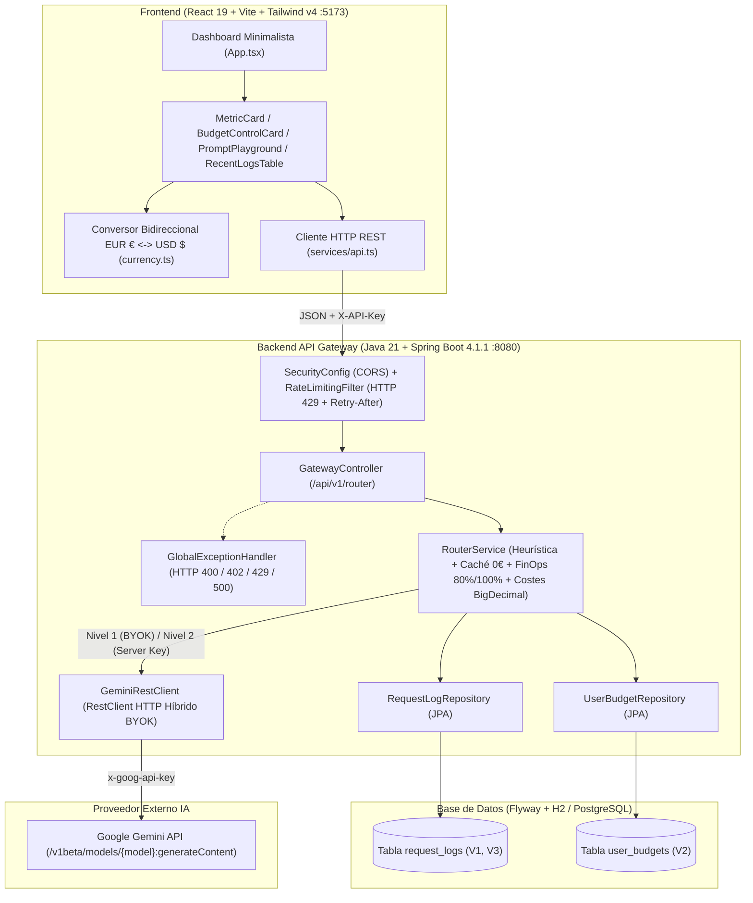

# 🛠️ Manual del Programador — AI Cost Router

Este documento constituye la especificación técnica completa de **AI Cost Router**. Describe la arquitectura interna del sistema, el esquema de base de datos gobernado por Flyway, los algoritmos de enrutamiento, caché semántica y FinOps, la arquitectura de seguridad, el diseño del Frontend y el pipeline CI/CD.

---

## 🏗️ 1. Arquitectura General del Sistema

**AI Cost Router** implementa una arquitectura **Full-Stack desacoplada** organizada en un monorrepo con separación estricta de responsabilidades:

### Stack Tecnológico Detallado
| Dominio | Tecnología y Versión | Propósito |
| :--- | :--- | :--- |
| **Backend Core** | Java 21 LTS + Spring Boot 4.1.1 | API REST, inyección de dependencias, validación Jakarta y cliente HTTP (`RestClient`). |
| **Persistencia** | Spring Data JPA + Hibernate (`ddl-auto=validate`) | Mapeo objeto-relacional con validación estricta del esquema al arranque. |
| **Migraciones SQL** | Flyway (`spring-boot-starter-flyway` + `flyway-core`) | Control versionado determinista del esquema SQL (`V1`, `V2`, `V3`). |
| **Motor BD** | H2 Database (en memoria `airouterdb`) / PostgreSQL | Base de datos transaccional para desarrollo/tests e integración continua. |
| **Frontend Core** | React 19 + TypeScript 5.9 + Vite 8 | Interfaz de usuario reactiva con tipado estático estricto. |
| **Estilos y Gráficas** | Tailwind CSS v4 (`@tailwindcss/vite`), Lucide React, Recharts | Sistema de diseño estilo Vercel / `shadcn/ui` con **0 estilos en línea (`style=`)**. |
| **Calidad y CI/CD** | JUnit 5, Mockito, MockMvc (72 tests) + Vitest, RTL (24 tests) + GitHub Actions & Dependabot | 96 tests automatizados ejecutados en cada Pull Request. |

---

## 🗄️ 2. Modelo de Datos y Migraciones Flyway (`05-arquitecto-datos`)

Los scripts SQL residen en `airouter/src/main/resources/db/migration/`:

### 2.1. Historial de Migraciones
1. **`V1__create_request_logs_table.sql`:**
   * Crea la tabla `request_logs` (`id UUID PK`, `user_id VARCHAR(120)`, `prompt_content CLOB`, `model_routed VARCHAR(80)`, `tokens_estimated INTEGER`, `created_at TIMESTAMP`).
   * Crea los índices B-Tree `idx_request_logs_user_id`, `idx_request_logs_created_at` y `idx_request_logs_model_routed`.
2. **`V2__create_user_budgets_table.sql`:**
   * Crea la tabla `user_budgets` (`id UUID PK`, `user_id VARCHAR(120) UNIQUE`, `max_budget_usd NUMERIC(19, 6)`, `auto_downgrade_enabled BOOLEAN DEFAULT TRUE`, `updated_at TIMESTAMP`).
   * Crea la restricción de unicidad `uk_user_budgets_user_id` y el índice `idx_user_budgets_user_id`.
3. **`V3__add_cache_hit_to_request_logs.sql`:**
   * Añade a `request_logs` la columna `cache_hit BOOLEAN NOT NULL DEFAULT FALSE` y el índice `idx_request_logs_cache_hit`.
4. **`V4__create_api_keys_table.sql`:**
   * Crea la tabla `api_keys` (`id UUID PK`, `user_id VARCHAR(120)`, `key_name VARCHAR(100)`, `key_prefix VARCHAR(32)`, `key_hash VARCHAR(64) UNIQUE`, `active BOOLEAN DEFAULT TRUE`, `created_at TIMESTAMP`) e índices `idx_api_keys_user_id` e `idx_api_keys_key_hash`.
   * Implementa el principio de **cero secretos en texto plano en base de datos**: las claves emitidas (`air_live_<32_hex>`) se generan con `SecureRandom` y se resumen con `MessageDigest.getInstance("SHA-256")` (`HexFormat`), almacenando únicamente el hash de 64 caracteres.
5. **`V5__create_user_wallets_table.sql`:**
   * Crea la tabla `user_wallets` (`id UUID PK`, `user_id VARCHAR(120) UNIQUE`, `balance_usd NUMERIC(19, 6)`, `total_topped_up_usd NUMERIC(19, 6)`, `wallet_enforced BOOLEAN DEFAULT FALSE`, `last_payment_method VARCHAR(40)`, `updated_at TIMESTAMP`) e índice `idx_user_wallets_user_id`.
6. **`V6__add_latency_and_dlp_to_request_logs.sql`:**
   * Añade a `request_logs` las columnas `latency_ms BIGINT NOT NULL DEFAULT 0` (latencia extremo a extremo en milisegundos) y `redacted_items_count INTEGER NOT NULL DEFAULT 0` (contador de elementos sensibles anonimizados por el Escudo DLP).

### 2.2. Reglas de Diseño en Entidades JPA (`RequestLog.java` y `UserBudget.java`)
* **Prohibición de `@Data` en JPA:** Conforme a `GEMINI.md`, las entidades utilizan exclusivamente `@Entity`, `@Getter`, `@Setter`, `@Builder`, `@NoArgsConstructor` y `@AllArgsConstructor`.
* **Igualdad por Identificador:** `equals(Object)` y `hashCode()` se implementan manualmente comprobando únicamente `id != null && Objects.equals(id, other.id)` para evitar fallos con proxies perezosos de Hibernate.
* **Callbacks de Ciclo de Vida:** `@PrePersist` y `@PreUpdate` garantizan que `createdAt`, `updatedAt`, `cacheHit` (`false`) y `autoDowngradeEnabled` (`true`) nunca lleguen nulos a la base de datos.

---

## ⚙️ 3. Lógica de Negocio del Backend (`01-backend-java`)

### 3.1. Flujo Completo de Enrutamiento (`RouterService.routePrompt`)
Cuando `GatewayController` recibe `POST /api/v1/router/prompt`, `RouterService` ejecuta secuencialmente estos **6 pasos**:

1. **Saneamiento y Validación (`validateAndExtractPrompt` / `validateAndExtractUserId`):**
   * Verifica que ni `userId` ni `prompt` sean nulos o en blanco (lanzando `InvalidPromptException` -> HTTP `400` en caso contrario).
2. **Estimación Heurística de Tokens (`estimateTokens`):**
   * Cuenta las palabras separadas por `\\s+` y multiplica por el factor **`TOKENS_PER_WORD_FACTOR = 1.3`**, redondeando al alza (`Math.ceil`).
3. **Selección Inicial de Modelo (`selectOptimalModel`):**
   * Si `tokensEstimated > 50` (`SIMPLE_PROMPT_MAX_TOKENS`) o el prompt en minúsculas contiene términos de alta complejidad (`"arquitectura"`, `"refactorizar"`, `"optimizar"`, `"analizar en profundidad"`), selecciona **`gemini-2.5-pro`**; en caso contrario, selecciona **`gemini-2.5-flash`**.
4. **Evaluación del Cortafuegos Presupuestario FinOps (`applyBudgetFirewallAndSelectModel`):**
   * Consulta `userBudgetRepository.findByUserId(userId)`. Si el usuario tiene un límite activo (`maxBudgetUsd > 0`):
     * Calcula su gasto acumulado real (`currentSpendUsd`).
     * **Regla del 100% (Hard Cap):** Si `currentSpendUsd >= maxBudgetUsd`, aborta inmediatamente lanzando **`BudgetExceededException`**, que `GlobalExceptionHandler` convierte en **HTTP `402 Payment Required`**.
     * **Regla del 80% (Auto-Downgrade):** Si el uso es `>= 80.0%` y `autoDowngradeEnabled == true`, fuerza el modelo a **`gemini-2.5-flash`** aunque el paso 3 hubiera elegido `Pro`.
5. **Verificación de Caché Semántica de Coste Cero (`findCachedEntry`):**
   * Normaliza el prompt con `normalizePromptForCache` (`trim()`, colapso de espacios `\\s+` a `" "` y `toLowerCase(Locale.ROOT)`).
   * Si ya existe en `request_logs` un registro previo con el mismo prompt normalizado:
     * Marca **`cacheHit = true`**, recupera la respuesta previa en `< 5 ms` y **omite la llamada HTTP a Google Gemini**.
6. **Ejecución Híbrida de 3 Niveles (`resolveResponseText` + `GeminiRestClient`) y Persistencia:**
   * Si no hubo *Cache Hit* (`cacheHit = false`), resuelve la clave API activa:
     * **Nivel 1 (BYOK):** Cabecera `X-API-Key` enviada por el usuario en la petición.
     * **Nivel 2 (Servidor):** Propiedad `airouter.gemini.api-key` (`GEMINI_API_KEY`).
     * **Nivel 3 (Fallback a Simulación):** Si no hay clave o si `GeminiRestClient.generateContent(...)` devuelve `Optional.empty()` (por error de red, timeout o clave de prueba), genera una respuesta simulada determinista (`[Simulación AI Cost Router]...`).
   * Persiste la entidad `RequestLog` y devuelve el `record` inmutable `RouterResponse`.

---

### 3.2. Cliente HTTP Real (`clients/GeminiRestClient.java`)
* Construido sobre `org.springframework.web.client.RestClient` con `SimpleClientHttpRequestFactory` (`connectTimeout` y `readTimeout` gobernados por `airouter.gemini.timeout-seconds=15`).
* Invoca `POST {baseUrl}/v1beta/models/{model}:generateContent` enviando la clave en la cabecera **`x-goog-api-key`** (jamás en la URL para impedir que quede registrada en logs de acceso HTTP).
* En caso de `RestClientException`, registra el aviso enmascarando el secreto con `maskApiKey` (`AIza****`) y retorna `Optional.empty()`.

---

### 3.3. Cálculo Financiero con `BigDecimal` (`RouterService.getStats`)
* Todas las operaciones monetarias emplean `BigDecimal` con escala de **6 decimales** (`COST_SCALE = 6`) y redondeo `RoundingMode.HALF_UP`:
  * Tarifa `gemini-2.5-flash`: **`$0.15` USD / 1M tokens**.
  * Tarifa `gemini-2.5-pro`: **`$1.25` USD / 1M tokens**.
* **Tratamiento de la Caché Semántica:**
  * Los registros con `cacheHit == true` incrementan `totalRequests`, `totalTokensEstimated`, `cacheHits` y el coste de referencia `estimatedBaselineProCostUsd`, pero **no suman tokens facturados** a `estimatedActualCostUsd` (su coste real es `$0.000000 USD`), por lo que el 100% de su valor se refleja como ahorro neto en `estimatedSavingsUsd`.

---

## 🛡️ 4. Seguridad, Rate Limiting y CORS (`04-auditor-seguridad`)

1. **`RateLimitingFilter.java` (`OncePerRequestFilter`):**
   * Protege `POST /api/v1/router/prompt` mediante ventanas fijas de 60 segundos en memoria (`ConcurrentHashMap<String, RateLimitBucket>`) identificando al cliente por `X-API-Key` (prioritario) o IP (`RemoteAddr`).
   * Límite por defecto: **20 peticiones/minuto** (`airouter.security.rate-limit.requests-per-minute=20`).
   * **Protección Anti-Rotación por IP y Poda de Memoria (`security-audit`):** Aplica además un freno secundario por IP (`ip-guard:<ip>` con techo `maxRequestsPerMinute * 4`) cuando se envían cabeceras `X-API-Key` rotativas y purga automáticamente las ventanas caducadas si el mapa alcanza `MAX_TRACKED_BUCKETS` (`10.000`).
   * Al superarse, devuelve **HTTP `429 Too Many Requests`**, cabecera `Retry-After` (segundos restantes) y cuerpo JSON `ErrorResponse`, enmascarando la clave en los logs (`apikey:sk-***`).
2. **Endurecimiento Multi-Inquilino (`RouterService.java` y `application-prod.properties`):**
   * **Vinculación `ApiKey.userId == PromptRequest.userId`:** Una clave `air_live_...` válida solo autoriza cargos sobre el mismo `userId` propietario de la clave (`HTTP 401 Unauthorized` en caso contrario).
   * **Aislamiento de Caché Semántica BYOK:** Las respuestas simuladas en caché nunca eclipsan peticiones que incluyen una clave externa BYOK real, y las respuestas reales BYOK quedan acotadas a su propietario.
   * **Serialización Atómica de Billetera (`walletLocks`):** Las recargas y descuentos de saldo en `UserWallet` se sincronizan atómicamente por `userId` para impedir condiciones de carrera (*double-spend*).
   * **Perfil de Producción (`application-prod.properties`):** Deshabilita explícitamente la consola H2 (`spring.h2.console.enabled=false`).
2. **`SecurityConfig.java`:**
   * Registra `RateLimitingFilter` con prioridad `Ordered.HIGHEST_PRECEDENCE + 10`.
   * Aplica CORS restrictivo autorizando `http://localhost:5173`, métodos `GET, POST, OPTIONS` en `/api/v1/**` y `GET, PUT, DELETE, OPTIONS` en `/api/v1/router/budget/**`, exponiendo la cabecera `Retry-After`.

---

## 🎨 5. Arquitectura del Frontend (`02-frontend-ui`)

Ubicado en `frontend/src/`, construido con **React 19**, **TypeScript** y **Tailwind CSS v4** bajo la regla estricta de **cero atributos `style=` en línea**:

* **`utils/currency.ts` y `utils/csv.ts`:**
  * Tasa oficial interna `USD_TO_EUR_RATE = 0.92`.
  * `convertFromUsd(amountUsd, currency)` y `convertToUsd(amountInCurrency, currency)`: Conversión bidireccional `EUR <-> USD`.
  * `calculateLogCostUsd(modelRouted, tokensEstimated, cacheHit)` y `calculateBaselineProCostUsd(tokensEstimated)`: Cálculo individual por petición (`0` si `cacheHit === true`).
  * `sanitizeCsvCell(value)` y `exportLogsToCsv(logs, currency)` (`utils/csv.ts`): Exportación contable RFC 4180 con BOM UTF-8 (`\uFEFF`) y protección contra **CSV Formula Injection (DDE)** prefijando `'` ante celdas que comienzan por `=`, `+`, `-`, `@`, `\t` o `\r`.
* **Componentes Modulares (`components/`):**
  * `Header.tsx`: Filtro reactivo por `userId`, selector `EUR € / USD $`, conmutador de tema `Claro / Oscuro` sincronizado con `<meta name="color-scheme">` y sincronización manual.
  * `MetricCard.tsx` y `StatsCards.tsx`: Tarjetas KPI reutilizables con *Skeleton Loaders* (`animate-pulse`) y contador de `Caché Hit (0 €)`.
  * `BudgetControlCard.tsx`: Panel interactivo FinOps con barra de progreso SVG (`viewBox="0 0 100 6"`), presets rápidos y conmutador de degradación al 80%.
  * `PromptPlayground.tsx`: Simulador con soporte BYOK (`X-API-Key`), badges dinámicos (`Gemini API Real` vs `Modo Simulación`, `Caché Hit (0 €)`) y manejo de errores `400`, `402` y `429`.
  * `ModelDistributionChart.tsx`, `RecentLogsTable.tsx` y `LogInspectorDrawer.tsx`: Visualización analítica, tabla accesible (`role="region"`, `tabIndex={0}`) con botón `Exportar CSV` y visor modal nativo `<dialog>` (`showModal()`, `closedby="any"`, `overscroll-behavior: contain` y botones de copiado con región viva `` externa).

---

## 🔄 6. Integración Continua (CI/CD), Dependabot y Despliegue con Docker Compose

* **`.github/workflows/ci.yml`:** Pipeline con permisos restringidos (`contents: read`) que ejecuta en paralelo:
  * `backend-java-qa`: Java 21 (`temurin`) + `./mvnw clean test -B` (**67 tests**).
  * `frontend-react-qa`: Node 22 + `npm ci`, `npm run lint`, `npm test -- --run` (**23 tests**) y `npm run build`.
* **`.github/dependabot.yml`:** Auditoría semanal automática de dependencias para Maven (`/airouter`), npm (`/frontend`) y GitHub Actions (`/`).
* **Arquitectura de Contenedores (`docker-compose.yml`):**
  1. **`postgres` (`postgres:17-alpine`):** Base de datos relacional de producción con volumen persistente `postgres_data` y `healthcheck` (`pg_isready`) en la red aislada `airouter-net`.
  2. **`backend` (`airouter/Dockerfile`):** Construcción Multi-Stage con `eclipse-temurin:21-jdk-alpine` y ejecución en `eclipse-temurin:21-jre-alpine` bajo un usuario del sistema sin privilegios (`USER appuser`). Arranca con `SPRING_PROFILES_ACTIVE=prod` (`application-prod.properties`), ejecutando automáticamente las migraciones Flyway `V1`..`V5` contra PostgreSQL y deshabilitando `/h2-console`.
  3. **`frontend` (`frontend/Dockerfile` + `frontend/nginx.conf`):** Construcción estática con `node:22-alpine` servida por `nginx:1.27-alpine`, actuando como *Reverse Proxy* de `/api/` hacia `http://backend:8080/api/` e inyectando cabeceras de seguridad (`X-Content-Type-Options: nosniff`, `X-Frame-Options: DENY`, `Referrer-Policy: strict-origin-when-cross-origin`).
